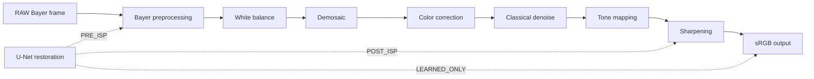

# SmartISP

SmartISP is a research-engineering scaffold for an intelligent hybrid smartphone
Image Signal Processing (ISP) system. It combines an explicit classical ISP
pipeline with a learned PyTorch restoration model and a reproducible evaluation
workflow for Google Colab T4 GPUs.

## Project status

This repository is at **stage 0: foundation and interfaces**. It contains the
package layout, public interfaces, configuration, dataset provenance guards,
documentation, and Colab workflow.

It does **not** contain trained checkpoints, completed algorithm
implementations, or measured evaluation results. Interface placeholders raise
`NotImplementedError` on purpose. No numbers in this repository should be
mistaken for experimental results.

## Why hybrid ISP

A classical ISP provides interpretable, deterministic stages: black-level
correction, white balance, demosaicing, color correction, denoising, tone
mapping, and sharpening. A learned restoration model can recover textures and
suppress artifacts that are difficult to model analytically. SmartISP keeps the
two parts separate so that each can be tested, ablated, and replaced.



The learned model can be inserted at explicit, documented points:

- `PRE_ISP`: restoration before the classical pipeline, typically on RAW or
  linear data.
- `POST_ISP`: restoration after the classical pipeline, on display-referred
  RGB.
- `LEARNED_ONLY`: no classical stages.
- `CLASSICAL_ONLY`: no learned stages.

The mode is configuration, never an implicit assumption.

## Repository layout

```text
SmartISP/
├── apps/
│   └── streamlit_app.py
├── configs/
│   ├── default.yaml
│   ├── colab_t4.yaml
│   └── datasets/
├── docs/
│   ├── architecture.md
│   ├── methodology.md
│   ├── datasets.md
│   ├── evaluation.md
│   └── colab.md
├── requirements/
│   ├── base.txt
│   ├── dev.txt
│   ├── app.txt
│   └── colab.txt
├── scripts/
│   ├── check_remote_gpu.py
│   ├── colab_smoke_test.py
│   └── colab_run.sh
├── src/smartisp/
│   ├── classical/
│   ├── data/
│   ├── evaluation/
│   ├── models/
│   ├── pipeline/
│   └── training/
├── tests/
├── pyproject.toml
├── uv.lock
└── README.md
```

## Quick start in WSL2

The repository lives at `/home/thushar/projects/SmartISP` inside WSL2 and is
opened from Windows through the UNC path
`\\wsl.localhost\Ubuntu\home\thushar\projects\SmartISP`.

```bash
cd /home/thushar/projects/SmartISP

uv sync --extra dev
uv run pytest
uv run ruff check .
uv run python -m smartisp.training.train --config configs/default.yaml --dry-run
uv run python -m smartisp.training.validate --config configs/default.yaml --dry-run
```

The default dev environment does not install PyTorch; the two torch-dependent
tests in `tests/test_models.py` skip until the `torch` extra is installed.

From Windows PowerShell, wrap Linux commands:

```powershell
wsl -d Ubuntu -- bash -lc "cd /home/thushar/projects/SmartISP && uv run pytest"
```

The Streamlit shell requires the optional app dependencies and the torch extra
for learned checkpoints:

```bash
uv sync --extra dev --extra app --extra torch
uv run streamlit run apps/streamlit_app.py
```

## Reproducibility

- `pyproject.toml` is the authoritative dependency specification.
- Every direct dependency is pinned to an exact version.
- `requirements/*.txt` are Colab-oriented pinned views of the same versions.
- `uv.lock` records the resolved graph; commit it with dependency changes.
- Configuration expands `${VAR}` and `${VAR:-default}` from exported environment
  variables; `.env` files are not auto-loaded.
- Random seeds, split manifests, metric settings, and hardware details must be
  recorded with every experiment.
- Datasets, credentials, checkpoints, and generated outputs stay out of Git.

## Dataset policy

SIDD images distributed as sRGB PNGs are display-referred images. **They are not
Bayer RAW mosaics.** SmartISP carries an explicit domain label (`bayer_raw`,
`linear_rgb`, or `srgb`) and rejects configurations that claim an sRGB PNG is
Bayer RAW. See [`docs/datasets.md`](docs/datasets.md) for the manifest format and
split rules.

## Colab T4 workflow

The Colab CLI is supported on Linux and macOS, so it runs inside WSL2, not in
Windows PowerShell. The verified local installation is `google-colab-cli`
0.7.5. A one-shot T4 check completed successfully with Python 3.13.16,
PyTorch 2.14.1+cu130, and a Tesla T4 (14.56 GB); the session was released
automatically.

```bash
colab new -s smartisp-t4 --gpu T4
colab install -s smartisp-t4 -r requirements/colab.txt
colab exec -s smartisp-t4 --env SMARTISP_REPO_URL=https://github.com/thushar-chandra/SmartISP.git -f scripts/colab_smoke_test.py
colab log -s smartisp-t4 -o outputs/colab-smoke.md
colab stop -s smartisp-t4
```

A WSL helper wraps the same sequence:

```bash
bash scripts/colab_run.sh smartisp-t4 T4
```

See [`docs/colab.md`](docs/colab.md) for authentication, data transfer,
checkpoint retrieval, and session cleanup details.

## Planned implementation stages

| Stage | Scope | Exit criterion |
| --- | --- | --- |
| 0 | Foundation, interfaces, provenance guards, docs | Package imports, checks pass, no fake results |
| 1 | Classical ISP algorithms | Unit-tested stages with deterministic fixtures |
| 2 | Dataset adapters and U-Net | Domain-aware loaders, model forward pass, loss tests |
| 3 | Training and validation on Colab T4 | Seeded runs, checkpoints, validation curves |
| 4 | Metrics, efficiency, ablation, failure analysis | Reproducible reports from real predictions |
| 5 | Demonstration and packaging | Streamlit app, example configs, release checklist |

## Evaluation

PSNR, SSIM, LPIPS, and CIEDE2000 Delta E are specified as interfaces. Runtime
and memory measurement includes warmup, device synchronization, and
p50/p90/p95 latency reporting. The ablation matrix and failure taxonomy are
documented but not executed. See [`docs/evaluation.md`](docs/evaluation.md).

## Documentation

- [`docs/architecture.md`](docs/architecture.md): module boundaries and data flow.
- [`docs/methodology.md`](docs/methodology.md): problem formulation and training plan.
- [`docs/datasets.md`](docs/datasets.md): dataset preparation and provenance.
- [`docs/evaluation.md`](docs/evaluation.md): metrics, efficiency, ablations, failures.
- [`docs/colab.md`](docs/colab.md): remote GPU workflow.
- [`AGENTS.md`](AGENTS.md): verified repository-specific commands for contributors.
